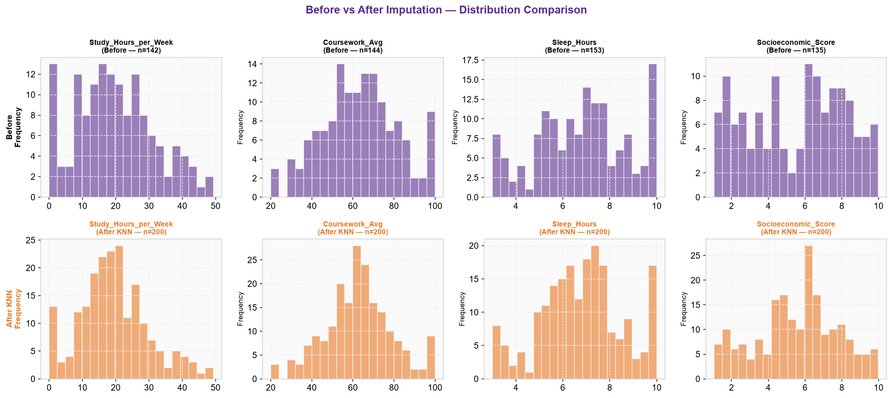
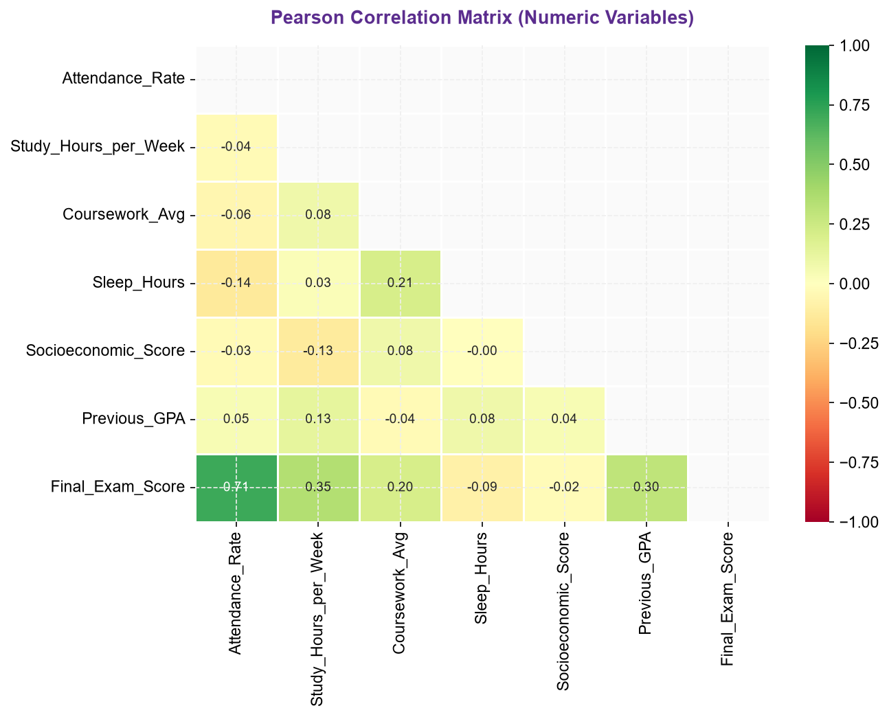

# Student Performance Analysis

A Python coursework project exploring missing data, relationships between student characteristics and examination scores, and two regression models.

**Stack:** Python · pandas · NumPy · scikit-learn · SciPy · Matplotlib · seaborn

**Status:** Runnable coursework demonstration; evaluation limitations are documented below.

[Overview](#overview) · [Data](#data) · [Getting started](#getting-started) · [Outputs](#outputs) · [Limitations](#limitations) · [Contributors](#contributors)

## Overview

This three-person group project examines how data preparation and modelling choices affect an analysis of student examination performance. The coursework report describes a synthetic dataset of 200 student records.

The supplied Python script includes:

- Variable classification, missing-value summaries and IQR-based outlier detection.
- K-nearest-neighbour imputation with five neighbours, followed by median filling of remaining numeric values.
- Before-and-after distribution plots and Kolmogorov–Smirnov comparisons.
- Descriptive statistics, correlations, scatter plots and comparisons by part-time employment status.
- Linear regression and random forest regression, with an 80/20 train/test split and five-fold cross-validation.
- R², root mean squared error (RMSE), mean absolute error (MAE), residual plots and feature-importance plots.

The report also discusses mean/median imputation and listwise deletion. The current script does not implement a complete benchmark comparing all of those strategies.

### Example output

These plots were generated using the built-in synthetic data. They illustrate the current analysis, including the preprocessing limitations described below; they are not evidence of real-world predictive performance.





## Data

The script looks for `student_performance_dataset.csv` in the working directory. If the file is absent, it generates **200 synthetic demonstration records** with NumPy seed `42`. No external dataset is required for this demonstration mode. Its results should not be assumed to reproduce the coursework report.

An external CSV must contain these columns:

| Role | Columns |
| --- | --- |
| Identifier | `Student_ID` |
| Demographic variables | `Age`, `Gender` |
| Academic and behavioural variables | `Attendance_Rate`, `Study_Hours_per_Week`, `Coursework_Avg`, `Sleep_Hours`, `Previous_GPA` |
| Contextual variables | `Part_Time_Job`, `Internet_Access`, `Socioeconomic_Score` |
| Prediction target | `Final_Exam_Score` |

The script expects `Yes`/`No` for `Part_Time_Job` and `Internet_Access`. Its synthetic generator uses `M`, `F` and `Other` for `Gender`.

To use a differently named CSV, update `DATA_PATH` near the beginning of the script. The current loader reads CSV files. Local CSV inputs are excluded from Git by default.

## Getting started

### Requirements

The demonstration was run successfully on Windows with **Python 3.14.6** and the six direct dependency versions pinned in [requirements.txt](requirements.txt). Installing those dependencies into a fresh environment has not been separately tested.

### Run on Windows

Download or clone the repository, then open PowerShell in the folder containing `analysis.py`.

Create an isolated Python environment:

```powershell
py -3.14 -m venv .venv
```

Install the required packages:

```powershell
.\.venv\Scripts\python.exe -m pip install -r requirements.txt
```

Run the analysis:

```powershell
.\.venv\Scripts\python.exe .\analysis.py
```

If using an external dataset, place the CSV in this folder before running. Otherwise, the script uses the synthetic demonstration data.

The script writes figures into the **working directory**, rather than into `assets/`. The figures committed under `assets/` are snapshots from the verified demonstration run.

## Outputs

The script prints data-audit summaries, descriptive statistics, model coefficients, evaluation metrics and cross-validation scores.

It writes nine figures:

| File | Content |
| --- | --- |
| `fig1_imputation_comparison.png` | Distributions before and after imputation |
| `fig2_final_exam_histogram.png` | Examination-score distribution |
| `fig3_scatter_plots.png` | Relationships between selected variables |
| `fig4_boxplot_parttime.png` | Comparison by part-time employment status |
| `fig5_correlation_heatmap.png` | Correlations between numeric variables |
| `fig6_model_comparison.png` | Model evaluation comparison |
| `fig7_actual_vs_predicted.png` | Observed and predicted examination scores |
| `fig8_feature_importance.png` | Random forest feature importance |
| `fig9_residual_plots.png` | Prediction residuals |

Rerunning replaces figures with these names in the working directory. Top-level generated figures are excluded from Git. Model-score figures are illustrative output from the current preprocessing and are subject to the leakage limitations below.

The implementation prints results and saves plots; it does not export a trained model or provide a web interface.

## Project structure

| Path | Purpose |
| --- | --- |
| `analysis.py` | Original coursework analysis, renamed without changing its contents |
| `requirements.txt` | Direct dependencies pinned to the successful demonstration environment |
| `assets/` | Nine generated plot snapshots |
| `docs/research-notes.md` | Coursework context, implementation details and report discrepancies |

## Limitations

- **Data leakage:** KNN imputation is fitted before the train/test split and includes the prediction target among its inputs. Reported performance cannot therefore be treated as an unbiased estimate on unseen data.
- **Cross-validation:** preprocessing occurs before folds are created. The random forest configuration also differs between the held-out evaluation and cross-validation.
- **Interpretation:** synthetic data and associations between variables do not establish real-world predictive reliability or causal effects.
- **Report consistency:** the coursework report contains conflicting performance values and model rankings. No model is presented here as a validated winner.

A future revision should separate predictors from the target before imputation, fit preprocessing within each training split, align model configurations and regenerate the report from the resulting outputs. These changes are not implemented in the supplied script.

## Contributors

Developed as a three-person coursework project for DG1FAID at ONCAMPUS Aston, academic year 2025–26. **Mohamed Kemouche** contributed data cleaning and imputation analysis.

When reporting an issue, include the script version, Python/package versions, whether you used the CSV or synthetic fallback, and the full error message. Use synthetic examples when sharing data.
